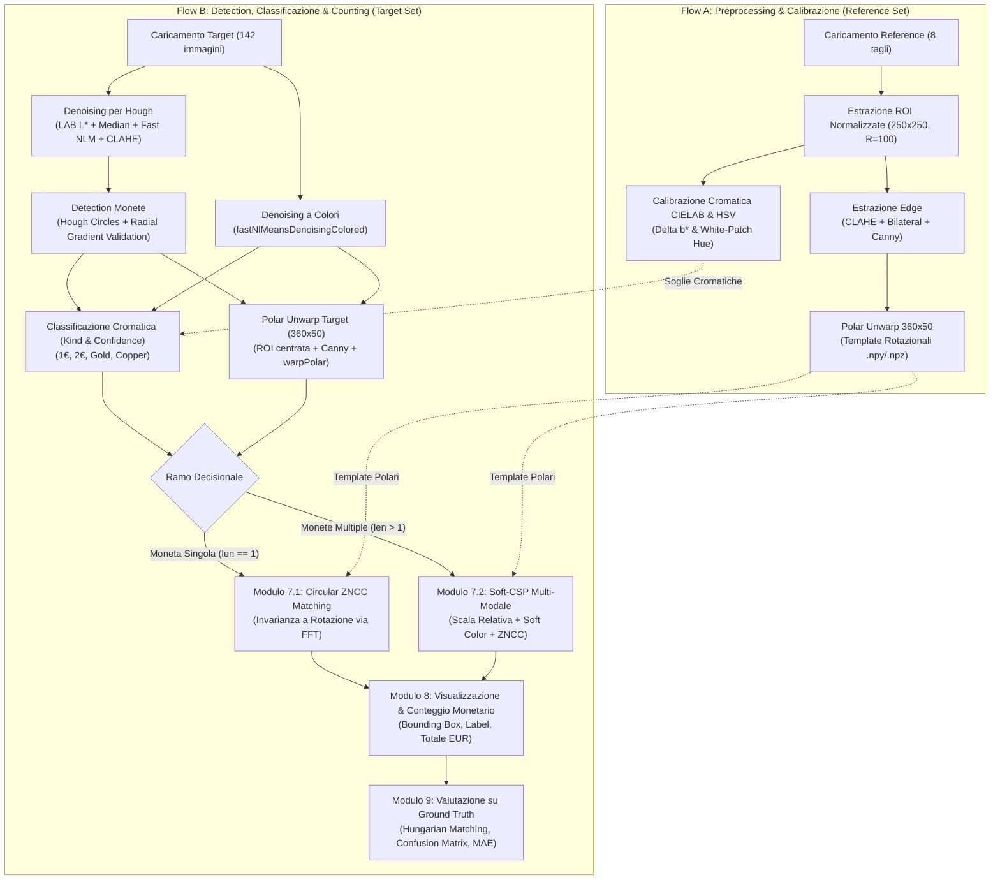

# 2cents-X-IPCV: Coin Detection, Classification, and Counting

> **Image Processing and Computer Vision (IPCV) - Assignment Module #1**  
> Università di Bologna (UniBo)  
> Soluzione completa sviluppata esclusivamente mediante **tecniche tradizionali di Computer Vision** (senza Deep Learning).

---

## 1. Descrizione del Task e Obiettivi

L'obiettivo dell'assignment è sviluppare una pipeline automatica di computer vision in grado di:
1. **Rilevare (Detection)** tutte le monete presenti in immagini fotografiche eterogenee (*in the wild*), con sfondi complessi (legno, tovaglie, tessuti, superfici riflettenti) e illuminazione non controllata.
2. **Classificare (Classification)** ciascuna moneta individuata in uno degli 8 tagli ufficiali dell'Euro:
   $$\mathcal{C} = \{ \text{1cent, 2cent, 5cent, 10cent, 20cent, 50cent, 1euro, 2euro} \}$$
3. **Calcolare il Valore Monetario (Counting)**:
   * Valore parziale per ogni singola immagine: $V_{\text{img}} = \sum_{i=1}^{N} \text{Valore}(c_i)$.
   * Valore totale complessivo cumulato su tutto il dataset target: $V_{\text{totale}} = \sum_{\text{img}} V_{\text{img}}$.

### Dataset Fornito
* **`reference_set`**: 8 immagini ad alta definizione (una per taglio), ciascuna contenente una singola moneta perfettamente centrata su sfondo uniforme. Serve per calibrare soglie cromatiche, parametri di edge extraction e generare le matrici polari di riferimento (template).
* **`target_set`**: 142 immagini contenenti una o più monete (fino a 8 monete per scena), disposte liberamente, soggette a rotazioni arbitrarie, ombre, occlusioni parziali, riflessi metallici e usura.

---

## 2. Architettura Generale della Pipeline

La soluzione adotta un'architettura **duale a due flussi complementari**:



---

## 3. Flow A: Preprocessing e Calibrazione (Reference Set)

Il Flusso A opera come fase di **calibrazione offline**. Elabora le 8 immagini di riferimento per estrarre le proprietà fisiche invarianti e serializzare i profili in `pipeline/artifacts/Flow_A_Reference/`.

### Modulo 1: Caricamento Reference Images
Carica le 8 immagini note con associazione deterministica del taglio nominale.

### Modulo 2: Estrazione e Normalizzazione Geometrica delle ROI
Per consentire il confronto diretto tra monete di dimensioni e posizioni arbitrarie, ciascuna moneta di riferimento viene isolata e ricampionata a una dimensione standard:
* **Canvas standard**: $250 \times 250$ pixel.
* **Raggio normalizzato di riferimento**: $R_{\text{target}} = 100.0$ pixel.
* **Trasformazione Affine**: dato il centro rilevato $(c_x, c_y)$ e il raggio originale $r$, si applica la matrice affine $T$:
  $$T = \begin{bmatrix} s & 0 & \frac{\text{canvas}}{2} - s \cdot c_x \\ 0 & s & \frac{\text{canvas}}{2} - s \cdot c_y \end{bmatrix}, \quad \text{con } s = \frac{R_{\text{target}}}{r}$$
* Viene applicata una **maschera circolare binaria pulita** a raggio $R_{\text{target}}$, eliminando qualunque residuo di sfondo.

### Modulo 3: Estrazione Feature Cromatiche e Calibrazione Soglie
La classificazione dei materiali sfrutta due descrittori fisici indipendenti:

1. **Discriminazione Bimetallica (1 Euro e 2 Euro)**:
   Le monete bimetalliche presentano una corona esterna e un nucleo centrale con leghe metalliche differenti (ottone/nichel).
   Si converte la ROI nello spazio colore **CIELAB** e si misura la differenza media del canale cromatico $b^*$ (giallo-blu) tra l'anello esterno ($r \in [65, 95]$ px) e il cerchio centrale ($r \in [0, 50]$ px):
   $$\Delta b^* = \overline{b^*}_{\text{anello}} - \overline{b^*}_{\text{centro}}$$
   * Per **1 Euro**: anello argento ($b^* \approx 0$), centro oro ($b^* \gg 0$) $\implies \Delta b^* < -6.0$.
   * Per **2 Euro**: anello oro ($b^* \gg 0$), centro argento ($b^* \approx 0$) $\implies \Delta b^* > +6.0$.
   * Per monete **Monometalliche**: $\Delta b^* \approx 0$.

2. **Discriminazione Monometallica (Rame vs Oro)**:
   Per le monete monometalliche si separano i tagli in rame (**copper**: 1c, 2c, 5c) da quelli in lega Nordic Gold (**gold**: 10c, 20c, 50c).
   * **Correzione per Costanza Cromatica (White-Patch Normalization)**:
     Per rimuovere dominanti di colore dell'illuminante prima dell'estrazione, si normalizza l'immagine scalando i canali RGB rispetto al massimo percentile della scena:
     $$I'_C(x, y) = \min\left(255, I_C(x, y) \cdot \frac{255}{\max_{u, v} I_C(u, v)}\right), \quad C \in \{R, G, B\}$$
   * **Tonalità (Hue)**:
     Si calcola la tonalità $H$ nello spazio colore **HSV**:
     $$H = \arctan2\left(\sqrt{3}(G - B),\, 2R - G - B\right)$$
     Si calcola la mediana del canale $H$ nella porzione interna della moneta e si calibra la soglia di separazione $T_{\text{hue}}$ e l'intervallo di sicurezza (*half-gap*).

Tutti i parametri calibrati vengono salvati in `color_profiles.json`.

### Modulo 4: Estrazione dei Rilievi e Mappe di Bordi
Per estrarre i contorni delle incisioni (bassorilievi) senza catturare il rumore della superficie metallica:
1. Conversione in scala di grigi.
2. **CLAHE** (*Contrast Limited Adaptive Histogram Equalization*): applicato con `clipLimit=2.0` e `tileGridSize=(8, 8)` per uniformare l'illuminazione locale ed esaltare i dettagli in bassorilievo.
3. **Bilateral Filter**: applicato con diametro $d=7$ e $\sigma_{\text{color}}=\sigma_{\text{space}}=75$ per smussare le imperfezioni e l'ossidazione preservando la nitidezza dei bordi:
   $$I_{\text{bilateral}}(x) = \frac{1}{W_p} \sum_{x_i \in \Omega} I(x_i) \exp\left(-\frac{\|x_i - x\|^2}{2\sigma_s^2}\right) \exp\left(-\frac{\|I(x_i) - I(x)\|^2}{2\sigma_r^2}\right)$$
4. **Canny Edge Detection**: con isteresi calibrata a $t_1 = 50$, $t_2 = 140$.
5. **Circular Outer Masking**: azzeramento dei bordi a $r \ge 99$ px per escludere il cerchio perimetrale esterno (il bordo della moneta) e conservare solo le incisioni interne.

### Modulo 5: Polar Unwarp (Coordinate Polari e Invarianza a Rotazione)
Per rendere il confronto tra monete **invariante a rotazioni arbitrarie**, la mappa dei bordi cartesiana $I(x, y)$ viene srotolata in coordinate polari lineari $(\theta, r)$:
1. Applicazione di un leggero filtro Gaussiano ($5 \times 5$) per rendere continue le transizioni dei bordi binari.
2. Trasformazione polare tramite `cv2.warpPolar`:
   $$x(\theta, r) = c_x + r \cos\theta, \quad y(\theta, r) = c_y + r \sin\theta$$
   con campionamento discretizzato su:
   * **Asse angolare ($\theta$)**: 360 bins (1 bin per grado, $\theta \in [0^\circ, 359^\circ]$).
   * **Asse radiale ($r$)**: 50 bins radiali campionati uniformemente da $r = 0$ a $r = 100$ px.
3. Normalizzazione dell'energia a valori float32 (somma unitaria):
   $$P_{\text{norm}}(\theta, r) = \frac{P(\theta, r)}{\sum_{\theta, r} P(\theta, r)}$$
4. Le matrici polari $360 \times 50$ delle 8 monete vengono salvate in formato lossless `.npy` e compattate in `polar_matrices.npz`.

---

## 4. Flow B: Inference, Detection, Classificazione e Counting (Target Set)

Il Flusso B esegue l'intera pipeline di predizione sulle immagini del target set.

### Modulo 1: Caricamento Target Images
Caricamento delle 142 immagini target da disco.

### Modulo 2: Denoising Ottimizzato per Hough Circles
Il rilevamento di cerchi tramite trasformata di Hough richiede gradienti chiari sul perimetro e l'assenza di texture parassite sul piano d'appoggio:
1. Estrazione del **canale di luminanza $L^*$** da CIELAB per eliminare riflessi cromatici.
2. **Median Blur ($5 \times 5$)**: abbattimento del rumore impulsivo sale-e-pepe.
3. **Fast Non-Local Means (NLM)**: sfrutta la ridondanza non locale dei patch per appiattire le tessiture dello sfondo (tovaglie, venature del legno) mantenendo i bordi perimetrali netti.
4. **Gaussian Blur ($5 \times 5$)** e **CLAHE locale** per stabilizzare l'accumulatore dei gradienti.

### Modulo 3: Detection Monete (Hough Circles + Radial Gradient Validation)
1. **Hough Circles Transform**:
   Viene eseguita su ogni immagine denoised con accumulatore a risoluzione piena (`dp=1`), raggio compreso tra $R_{\text{min}}=28$ e $R_{\text{max}}=140$ px, e distanza minima tra centri per evitare cerchi duplicati.
2. **Filtro di Validazione a Supporto Radiale (Radial Gradient Support)**:
   Per eliminare eventuali falsi positivi generati da nodi del legno o texture circolari, per ciascun cerchio candidato $(c_x, c_y, r)$ si calcola la coerenza dei gradienti lungo $K=72$ punti campionati sul perimetro:
   $$\text{EdgeScore} = \frac{1}{K} \sum_{k=1}^{K} \left( \nabla I(x_k, y_k) \cdot \mathbf{n}_k \right)$$
   dove $\mathbf{n}_k$ è il versore radiale uscente. I cerchi con supporto inferiore alla soglia vengono scartati.
3. **Generazione Manifest Unificato**:
   Tutte le monete validate vengono salvate nella struttura dati centralizzata `annotated_images.json`.
   * **Risultato della Detection**: **$99.39\%$ Precision, $99.39\%$ Recall, $99.39\%$ F1-Score** (326 True Positives su 328 monete reali).

### Modulo 4: Denoising a Colori per Classificazione Cromatica
A differenza del Modulo 2 (ottimizzato per la geometria), la classificazione cromatica richiede fedeltà dei colori:
* Si applica `cv2.fastNlMeansDenoisingColored` con forza di filtraggio $h=12.0$ e $h_{\text{color}}=20.0$.
* Si applica un Median Filter $3 \times 3$ per rimuovere artefatti ad alta frequenza senza alterare la distribuzione dell'istogramma cromatico.

### Modulo 5: Classificazione Cromatica (Kind & Confidence)
Per ciascuna moneta rilevata si estraggono $\Delta b^*$ e l'istogramma di Tonalità normalizzato (White-Patch) con le soglie del Modulo 3:
* Si assegna a ogni moneta la macro-classe (`kind`): `'1 euro'`, `'2 euro'`, `'gold'` o `'copper'`.
* Si calcola la **confidenza probabilistica** come distanza continua dalla soglia decisionale in unità di *half-gap*:
  $$\text{confidence} = \min\left(1.0, \frac{|\text{misura} - T_{\text{soglia}}|}{\text{half\_gap}}\right)$$
* Se $\text{confidence} \ge T_{\text{confident}}$, la decisione è marcata come `confident = True`; altrimenti `confident = False` (moneta cromatica incerta a causa di ossidazione o illuminazione sfavorevole).

### Modulo 6: Polar Unwarp delle Monete Target
Per ciascuna moneta target rilevata:
1. Si estrae la ROI centrata e normalizzata a $250 \times 250$ px con $R=100$ px.
2. Si applica la medesima pipeline del Flusso A: CLAHE $\to$ Bilateral $\to$ Canny ($t_1=50, t_2=140$) $\to$ Outer Masking ($r \le 99$) $\to$ Gaussian Blur ($5 \times 5$).
3. Si esegue lo srotolamento polare (`cv2.warpPolar`) ottenendo la matrice normalizzata $360 \times 50$, salvata come file `.npy`.

---

## 5. Ramo Decisionale di Classificazione (Modulo 7)

A questo punto la pipeline si sdoppia in due strategie complementari in base al numero di monete nell'immagine:

```
                          [ Immagine Target ]
                                   |
                         Numero di Monete (N)
                                  / \
                                 /   \
                         N == 1 /     \ N > 1
                               /       \
                     [ Modulo 7.1 ]   [ Modulo 7.2 ]
                     Single-Coin      Multi-Coin
                     Polar ZNCC       Soft-CSP Multi-Modale
```

### Modulo 7.1: Moneta Singola (Pruning Colore + Circular ZNCC Matching)
* **Motivazione**: Quando un'immagine contiene una sola moneta, **non esiste alcun riferimento di scala relativo**; la dimensione in pixel dipende unicamente dall'altezza della fotocamera. La discriminazione deve basarsi esclusivamente sull'aspetto visivo e sui bassorilievi interni.
* **Pruning Cromatico**: I candidati vengono ristretti tramite `kind`:
  * `'1 euro'` $\implies$ `['1euro']`
  * `'2 euro'` $\implies$ `['2euro']`
  * `'gold'` $\implies$ `['10cent', '20cent', '50cent']`
  * `'copper'` $\implies$ `['1cent', '2cent', '5cent']`
* **Zero-Normalized Cross-Correlation (ZNCC) Circolare**:
  Per ciascun candidato $c$, si confronta la matrice polare target $T(\theta, r)$ con la matrice reference $R(\theta, r)$.
  Per garantire l'invarianza alla rotazione, si calcola la correlazione per tutti i possibili $360$ shift angolari $\Delta\theta \in [0^\circ, 359^\circ]$:
  $$\text{ZNCC}(\Delta\theta) = \frac{\sum_{\theta=0}^{359} \sum_{r=0}^{49} (T(\theta + \Delta\theta, r) - \bar{T}) (R(\theta, r) - \bar{R})}{\sqrt{\sum (T - \bar{T})^2 \cdot \sum (R - \bar{R})^2}}$$
* **Calcolo Efficiente tramite FFT**:
  Sfruttando il Teorema della Correlazione, la correlazione circolare lungo l'asse angolare per tutti i 360 angoli contemporaneamente viene calcolata in tempo $O(N_r \cdot N_\theta \log N_\theta)$ tramite Fast Fourier Transform:
  $$\text{CorrMatrix}(\Delta\theta, r) = \mathcal{F}^{-1}\left( \mathcal{F}(T_{\text{norm}}) \cdot \mathcal{F}(R_{\text{norm}})^* \right)$$
  $$\text{ZNCC\_Profile}(\Delta\theta) = \sum_{r=0}^{49} \text{CorrMatrix}(\Delta\theta, r)$$
* Si seleziona il candidato che massimizza il punteggio:
  $$c^* = \arg\max_{c \in \text{candidati}} \left( \max_{\Delta\theta} \text{ZNCC}_c(\Delta\theta) \right)$$

---

### Modulo 7.2: Monete Multiple (Soft-CSP Multi-Modale)

Quando un'immagine contiene più monete ($N > 1$), esse giacciono tutte sullo stesso piano focale e alla medesima distanza dalla lente. Il sistema sfrutta questo vincolo fisico combinandolo con la ZNCC e il colore attraverso un modello di **Soft Constraint Satisfaction Problem (Soft-CSP)**.

#### 1. Principio Fisico della Scala Condivisa
Poiché la scala metrico-pixel $S$ deve essere identica per tutte le monete della scena:
$$S_i = \frac{r_i}{D_i / 2} = \text{costante} \quad \forall i \in \{1, \dots, N\}$$
dove $r_i$ è il raggio rilevato in pixel e $D_i$ è il diametro fisico nominale in millimetri:

| Taglio | Diametro Nominale ($D$ mm) | Gruppo Cromatico |
| :---: | :---: | :---: |
| **1 cent** | 16.25 mm | Copper |
| **2 cent** | 18.75 mm | Copper |
| **10 cent** | 19.75 mm | Gold |
| **5 cent** | 21.25 mm | Copper |
| **20 cent** | 22.25 mm | Gold |
| **1 euro** | 23.25 mm | 1 Euro (Bimetallica) |
| **50 cent** | 24.25 mm | Gold |
| **2 euro** | 25.75 mm | 2 Euro (Bimetallica) |

#### 2. Soft Pruning Cromatico (Gestione delle Monete a Bassa Confidenza)
* Se `confident == True`: i candidati per la moneta $i$ sono ristretti al gruppo predetto.
* Se `confident == False` (es. un 5 centesimi ossidato scambiato per oro): lo spazio dei candidati si allarga includendo i gruppi cromatici contigui (per monometalliche: tutti i 6 tagli rame + oro).
* L'assegnazione di un taglio appartenente a un gruppo diverso da quello osservato subisce una **Penalità Cromatica morbida**:
  $$\text{Penalità}_{\text{Colore}}(i, y_i) = w_{\text{color}} \cdot \text{confidence}_i \quad \text{se } \text{kind}(y_i) \neq \text{kind}_{\text{pred}}$$
  Se la confidenza del colore era molto bassa (es. $0.15$), la penalità è minima e può essere agevolmente compensata dalla coerenza geometrica e dalla ZNCC.

#### 3. Incertezza Dimensionale (Raggi Simili)
Se nella stessa immagine due monete presentano raggi molto vicini in pixel ($|r_i - r_j| \le \tau_{\text{sim}}$, con $\tau_{\text{sim}} = 4.0$ px), la sola stima di raggio è ambigua. Si attiva un flag di incertezza dimensionale:
$$\text{DimUncertainty}_i = \begin{cases} 1.0 & \text{se } \exists j \neq i : |r_i - r_j| \le \tau_{\text{sim}} \\ 0.0 & \text{altrimenti} \end{cases}$$

#### 4. Termine ZNCC Dinamico Pesato
Per ogni moneta $i$ e classe candidata $y_i$, il bonus ZNCC viene modulato dinamicamente:
$$W_i = w_{\text{base}} \cdot \Big( 1.0 + \alpha \cdot (1 - \text{conf}_i) + \beta \cdot \text{DimUncertainty}_i \Big)$$
* $w_{\text{base}} = 1.5$ (volutamente ridotto rispetto ai vincoli geometrici duri).
* Il peso aumenta quando il colore è incerto (aiutando a recuperare il taglio giusto).
* Il peso aumenta quando i raggi sono vicini (fungendo da *tie-breaker* per rompere l'ambiguità tra scale parallele, es. $10\text{c}/20\text{c}$ vs $20\text{c}/50\text{c}$).

#### 5. Funzione di Ottimizzazione Globale (Score della Tupla)
Per ciascuna tupla candidata $\mathbf{y} = (y_1, \dots, y_N) \in \text{Candidati}_1 \times \dots \times \text{Candidati}_N$:

$$\text{Score}(\mathbf{y}) = \text{Score}_{\text{Geom}}(\mathbf{y}) - \sum_{i=1}^{N} \text{Penalità}_{\text{Colore}}(i, y_i) + \sum_{i=1}^{N} W_i \cdot \max(0, \text{ZNCC}(i, y_i))$$

dove la componente geometrica è definita da:
$$\text{Score}_{\text{Geom}}(\mathbf{y}) = - w_{\text{cv}} \cdot \text{CV}(S) - w_{\text{ratio}} \cdot \overline{\text{err}}_{\text{ratio}} - w_{\text{viol}} \cdot \text{Violazioni}$$
* **Coefficiente di Variazione della Scala**:
  $$\text{CV}(S) = \frac{\sigma_S}{\mu_S + \epsilon}, \quad S_i = \frac{r_i}{D(y_i) / 2}$$
* **Errore Medio sui Rapporti a Coppie**:
  $$\overline{\text{err}}_{\text{ratio}} = \frac{1}{\binom{N}{2}} \sum_{i < j} \frac{|(r_i / r_j) - (D(y_i) / D(y_j))|}{D(y_i) / D(y_j)}$$
* **Violazioni di Monotonicità**:
  $$\text{Violazioni} = \sum_{i < j} \mathbf{1}\Big( r_i > r_j + \tau_{\text{mono}} \;\land\; D(y_i) < D(y_j) \Big)$$

Con pesi calibrati: $w_{\text{viol}} = 50.0$, $w_{\text{cv}} = 20.0$, $w_{\text{ratio}} = 10.0$, $w_{\text{color}} = 3.0$, $w_{\text{base}} = 1.5$.
La tupla ottima $\mathbf{y}^* = \arg\max_\mathbf{y} \text{Score}(\mathbf{y})$ garantisce il perfetto equilibrio tra legge fisica globale e verosimiglianza visiva locale.

---

## 6. Modulo 8: Visualizzazione dei Risultati e Conteggio Monetario

Per ciascuna immagine target:
1. Viene renderizzata l'immagine con **bounding box quadrati** centrati sulle monete rilevate.
2. Viene posizionato un **banner superiore semitrasparente** con il nome della denominazione predetta e il relativo punteggio ZNCC (es. `50CENT (0.35)`).
3. Viene visualizzato nell'intestazione il valore monetario parziale dell'immagine:
   $$V_{\text{img}} = \sum_{i=1}^{N} \text{Valore}(c_i) \text{ EUR}$$
4. Vengono serializzati i risultati in `final_counting_summary.json` e generate le immagini ad alta risoluzione in `pipeline/artifacts/Flow_B_Target/module8_visualize_results/`.

---

## 7. Modulo 9: Valutazione Sperimentale e Risultati

La valutazione viene condotta confrontando le predizioni con il Ground Truth ufficiale (`annotations_with_position.csv`).

### Bipartite Matching con Algoritmo Ungherese
Per evitare ambiguità spaziali tra monete multiple vicine, l'accoppiamento tra monete rilevate $\hat{c}_i$ e monete annotate nel GT $g_j$ è risolto tramite assegnamento ottimo lineare (Algoritmo Ungherese) minimizzando la distanza euclidea:
$$\mathbf{X}^* = \arg\min_{\mathbf{X}} \sum_{i} \sum_{j} X_{i, j} \|\mathbf{p}_i - \mathbf{p}_j^{\text{GT}}\|_2$$
Un detection è considerato **True Positive (TP)** se la distanza dal centro GT è $d \le 50.0$ pixel.

---

### Risultati Quantitativi Finali (Dataset Target: 142 Immagini, 328 Monete)

#### 1. Metriche di Detection (Hough Circles Validata)
* **Monete Reali (GT)**: 328
* **Cerchi Rilevati dalla Pipeline**: 328
* **True Positives**: 326 (99.39%)
* **False Positives**: 2
* **False Negatives**: 2
* **Precision / Recall / F1-Score Detection**: **99.39%**

#### 2. Metriche di Classificazione
* **Accuratezza sulle Monete Rilevate**: **70.86%** (326 monete)
* **Accuratezza Totale su tutto il GT**: **70.43%** (328 monete)
* **Accuratezza a Livello Macro-Colore**: **86.81%**
* **Macro Average F1-Score**: **70.54%**
* **Weighted Average F1-Score**: **71.15%**

#### 3. Dettaglio per Denominazione (Precision, Recall, F1-Score)

| Denominazione | Support (GT) | Precision | Recall | F1-Score |
| :--- | :---: | :---: | :---: | :---: |
| **1 cent** | 37 | 60.5% | 62.2% | **61.3%** |
| **2 cent** | 50 | 65.8% | 54.0% | **59.3%** |
| **5 cent** | 57 | 78.8% | 71.9% | **75.2%** |
| **10 cent** | 31 | 47.1% | 77.4% | **58.5%** |
| **20 cent** | 49 | 75.6% | 63.3% | **68.9%** |
| **50 cent** | 26 | 59.3% | 61.5% | **60.4%** |
| **1 euro** | 49 | 97.7% | 87.8% | **92.5%** |
| **2 euro** | 27 | 81.2% | 96.3% | **88.1%** |

#### 4. Metriche di Conteggio Monetario
* **Valore Reale Ground Truth**: **134.13 €**
* **Valore Predetto dalla Pipeline**: **138.70 €**
* **Differenza Assoluta Cumulata**: **+4.57 €** (Errore relativo globale: **3.41%**)
* **Mean Absolute Error (MAE)**: **0.19 €** per immagine
* **Immagini con Conteggio Esatto al Centesimo**: **76 su 142 (53.52%)**
* **Immagini con Errore $\le$ 0.20 €**: **79.58%**

---

## 8. Struttura del Repository e File

```
2cents-X-IPCV/
├── coin_dataset/
│   ├── reference_set/                      # 8 immagini di riferimento con etichetta nel nome
│   └── target_set/                         # 142 immagini target senza etichette
├── pipeline/
│   ├── conf/                               # Configurazioni e parametri calibrati
│   │   ├── annotations_with_position.csv   # Ground Truth con coordinate spaziali e tagli
│   │   ├── Flow_A_Reference/
│   │   │   └── edge_params.json            # Soglie Canny e filtri per ciascuna moneta reference
│   │   └── Flow_B_Target/
│   │       ├── denoise_for_detection_params.json
│   │       ├── coin_detection_params.json
│   │       ├── denoise_colored_params.json
│   │       ├── coin_color_classification_params.json
│   │       ├── single_coin_classification_params.json
│   │       └── multi_coin_classification_params.json   # Parametri del Soft-CSP Multi-Modale
│   ├── artifacts/                          # Artefatti intermedi lossless (generati a runtime)
│   │   ├── Flow_A_Reference/               # ROI normalizzate, mappe edge, polar templates (.npz)
│   │   └── Flow_B_Target/                  # Immagini denoised, manifest unificato, ROI classificate
│   └── src/
│       ├── Flow_A_Reference/
│       │   ├── flow_A_reference.ipynb      # Notebook di calibrazione Flow A
│       │   ├── module1_load_references.py
│       │   ├── module2_extract_roi.py
│       │   ├── module3_extract_color.py
│       │   ├── module4_extract_edges.py
│       │   └── module5_polar_unwarp.py
│       └── Flow_B_Target/
│           ├── flow_b_target.ipynb          # Notebook principale di esecuzione Flow B
│           ├── module1_load_target.py
│           ├── module2_denoise_for_detection.py
│           ├── module3_coin_detection.py
│           ├── module4_denoise_colored.py
│           ├── module5_coin_color_classification.py
│           ├── module6_polar_unwarp.py
│           ├── module7_1_single_coin_classification.py
│           ├── module7_2_multi_coin_classification.py  # Soft-CSP Multi-Modale
│           ├── module8_visualize_results.py
│           └── module9_evaluation.py
└── README.md
```

---

## 9. Istruzioni per l'Esecuzione

### Prerequisiti
Ambiente Conda raccomandato con Python 3.10+ e dipendenze standard di Computer Vision:
```bash
conda activate SMM2526
pip install opencv-python numpy matplotlib scipy scikit-learn pandas seaborn
```

### Esecuzione della Pipeline
1. **Calibrazione (Flow A)**:
   Aprire ed eseguire sequenzialmente il notebook:
   `pipeline/src/Flow_A_Reference/flow_A_reference.ipynb`
   Genera i profili cromatici in `color_profiles.json` e le matrici polari reference in `polar_matrices.npz`.

2. **Inference, Detection & Valutazione (Flow B)**:
   Aprire ed eseguire il notebook principale:
   `pipeline/src/Flow_B_Target/flow_b_target.ipynb`
   Il notebook esegue in ordine:
   * Caricamento e Denoising (Celle 1-2)
   * Detection Hough con validazione bordi (Cella 3)
   * Denoising cromatico e Classificazione colore (Celle 4-5)
   * Estrazione bordi e Polar Unwarp target (Cella 6)
   * Classificazione disgiunta Moneta Singola (ZNCC) e Monete Multiple (Soft-CSP) (Cella 7)
   * Rendering grafico e conteggio monetario (Cella 8)
   * Valutazione quantitativa completa su Ground Truth con matrice di confusione e dashboard grafica (Cella 9).